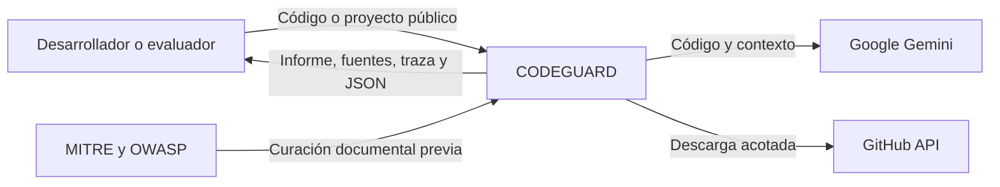
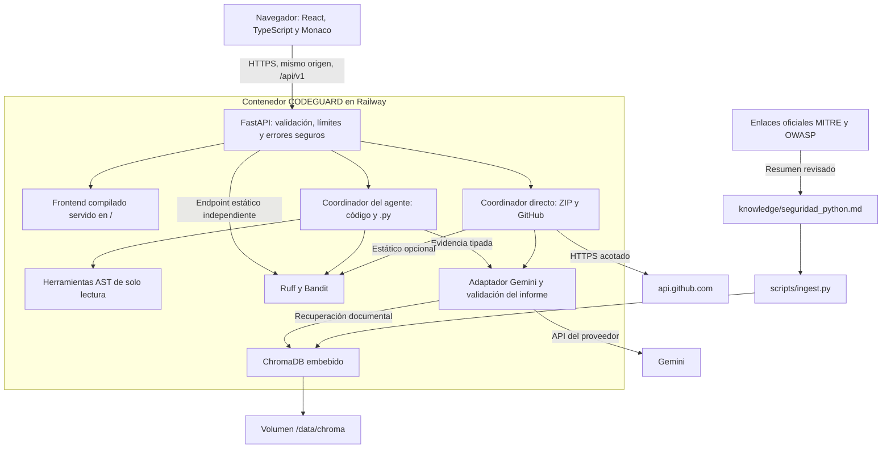
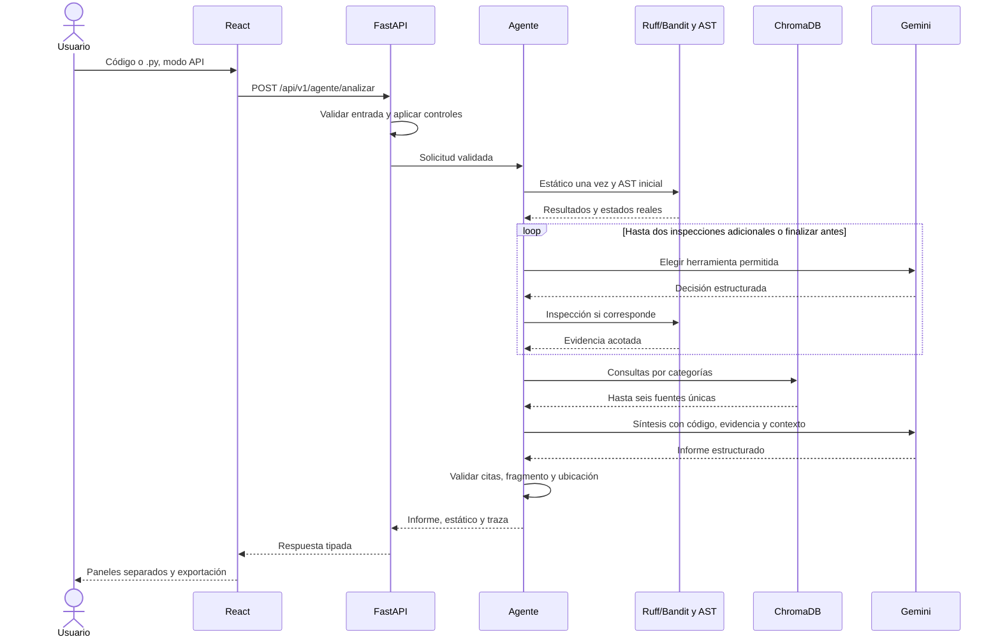

# 03. Arquitectura vigente de CODEGUARD

Revisión documental: 5 de noviembre de 2026. Base: `main`, `65675e2` (PR #31).
La [arquitectura de revisión 2](historico/03-arquitectura-revision2.md) se conserva
como registro histórico. La revisión Git no identifica por sí sola la versión
que Railway tiene desplegada.

## Contexto — C4 nivel 1

Las páginas oficiales son referencias del conocimiento curado. El agente no
realiza navegación web libre ni admite URLs de documentación generadas por el
código recibido.

## Componentes — C4 nivel 2

React se compila al construir la imagen; Node no es un servidor adicional en
producción. FastAPI sirve frontend y API. `VITE_API_BASE_URL` puede quedar vacío
para utilizar rutas relativas. Agent Lab está en `/agente/demo`.

## Flujo de una consulta del agente

El diagrama describe el recorrido exitoso. Un fallo del proveedor puede conservar
evidencia local y devolver estado parcial; no implica que todas las etapas se
hayan ejecutado. Las trazas identifican decisiones realmente realizadas.

## Modalidades y límites de confianza

| Modalidad | Flujo actual | Respaldo y citas |
|---|---|---|
| Código / `.py` desde React en API | Agente integrado | Estático obligatorio, AST y síntesis con hasta seis fuentes |
| `/analizar` y `/archivos` directos | Compatibilidad del análisis directo | Estático según `STATIC_ANALYSIS_ENABLED`; límite tres para recuperación de seguridad |
| ZIP / GitHub | Directo por archivo | Citas aisladas por informe; límites de entrada y corte del proveedor tras fallo parcial |
| `/estatico/analizar` | Ruff/Bandit sin Gemini | Reglas y documentación de cada herramienta, sin citas RAG inventadas |
| `/agente/previsualizar` | AST sin Gemini | Inspección sintáctica, no generación |
| Demo React | Respuestas ilustrativas locales | No acredita análisis del proveedor ni recuperación documental |

Entradas, documentos y resultados de herramientas son datos no confiables,
serializados aparte de las instrucciones. La lista de herramientas es cerrada;
el modelo no ejecuta órdenes arbitrarias. Ruff/Bandit leen texto para analizarlo,
sin ejecutar ni importar el programa recibido.

Un ID válido y una coincidencia literal no prueban pertinencia semántica ni
explotabilidad. El agente descarta hallazgos inválidos individualmente y conserva
los válidos con estado parcial; el flujo directo conserva su validación global
de referencias.

## Datos y despliegue

- Fuente curada: seis reglas en `knowledge/seguridad_python.md`. Ver
  [inventario](04-fuentes.md) y enlaces de origen en `data/raw/`.
- Colección obligatoria: `seguridad_python`. `contexto_proyecto` es complementaria
  y no sustituye las fuentes de seguridad.
- Docker/Railway: `CHROMA_PATH=/data/chroma`, volumen en `/data`. El arranque
  recupera un índice no vacío o realiza ingesta inicial si hace falta.
- Imagen: build frontend Node 22 y ejecución Python 3.13. El entrypoint prepara
  permisos del volumen y la aplicación se ejecuta como UID 10001.
- API key solo en backend. No utilizar variables `VITE_*` para secretos.
- Un proceso y una réplica para ChromaDB embebido y límites en memoria. No se
  afirma alta disponibilidad ni recuperación de backups probada.
- No hay historial persistente de informes de usuarios. El código se procesa
  en memoria/temporales y se envía al proveedor en modo API; esto no acredita
  ausencia de retención por servicios externos.

## Evidencia y alcance

La validación local está en [17-agente-integrado.md](17-agente-integrado.md).
La comparación de citas y la falta del log independiente se explican en
[cierre QA](12-cierre-qa-entrega4.md). Una corrida pública previa no valida
automáticamente una versión posterior del agente.

Contratos: [RAG](06-rag.md), [estático](10-analisis-estatico.md),
[resiliencia](11-resiliencia-gemini.md) y [despliegue](despliegue.md).
