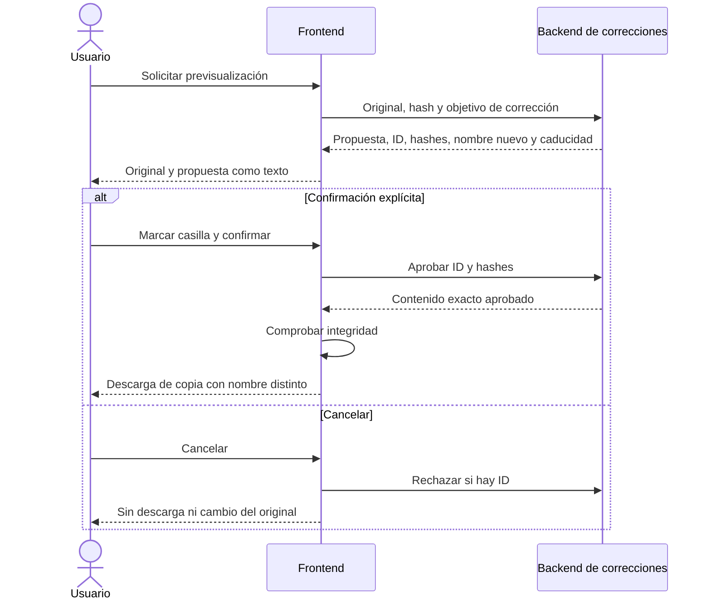
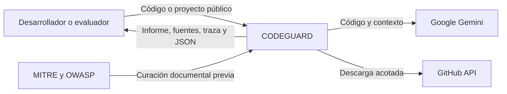
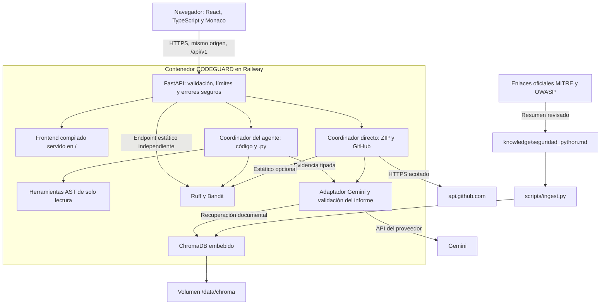
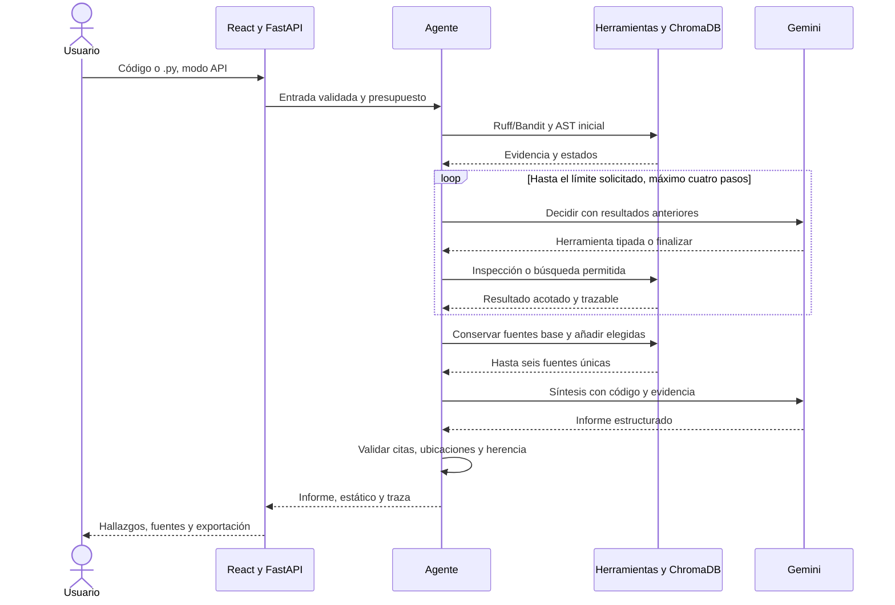

> Actualización de producto del 7 de noviembre: Directa es la ruta inicial en API
> para código/.py; Agente se elige explícitamente. ZIP/GitHub siguen directos.
> Decisión y evidencia: [ADR E4-13](09-decisiones.md).

# 03. Arquitectura vigente de CODEGUARD

Actualización del 7 de noviembre de 2026. Frontend y backend comparten los
contratos de correcciones y presupuesto. Ambas interfaces públicas se comprobaron
en c522c24; el contador de presupuestos anidados se corrigió y verificó en 0a6707b.
La evidencia y los límites están en [el cierre vigente](37-cierre-verificado.md).

Este recorrido está implementado. Las pruebas de navegador con proveedor simulado
se distinguen de las decisiones HTTP reales documentadas. Generar una propuesta
no autoriza ejecutar el código.

La [arquitectura de revisión 2](historico/03-arquitectura-revision2.md) se conserva
como histórico. La revisión de Git no acredita por sí sola qué versión está activa:
se contrasta el enlace SHA del despliegue Railway y el estado successful.

## Contexto — C4 nivel 1

Las páginas oficiales son referencias del conocimiento curado. El agente no
realiza navegación web libre ni admite URLs de documentación generadas por el
código recibido.

## Componentes — C4 nivel 2

React se compila al construir la imagen; Node no es un servidor adicional en
producción. FastAPI sirve frontend y API. `VITE_API_BASE_URL` puede quedar vacío
para utilizar rutas relativas. Agent Lab está en `/agente/demo`.

## Flujo de una consulta del agente

El diagrama describe el recorrido exitoso. Un fallo del proveedor puede conservar
evidencia local y devolver estado parcial; no implica que todas las etapas se
hayan ejecutado. Las trazas identifican decisiones realmente realizadas.

## Modalidades y límites de confianza

| Modalidad | Flujo actual | Respaldo y citas |
|---|---|---|
| Código / `.py` desde React en API | Directa inicial; Agente al seleccionarlo | Estático obligatorio, AST y síntesis con hasta seis fuentes |
| `/analizar` y `/archivos` directos | Compatibilidad del análisis directo | Estático según `STATIC_ANALYSIS_ENABLED`; límite tres para recuperación de seguridad |
| ZIP / GitHub | Directo por archivo | Citas aisladas por informe; límites de entrada y corte del proveedor tras fallo parcial |
| `/estatico/analizar` | Ruff/Bandit sin Gemini | Reglas y documentación de cada herramienta, sin citas RAG inventadas |
| `/agente/previsualizar` | AST sin Gemini | Inspección sintáctica, no generación |
| Demo React | Respuestas ilustrativas locales | No acredita análisis del proveedor ni recuperación documental |

Entradas, documentos y resultados de herramientas son datos no confiables,
serializados aparte de las instrucciones. La lista de herramientas es cerrada;
el modelo no ejecuta órdenes arbitrarias. Ruff/Bandit leen texto para analizarlo,
sin ejecutar ni importar el programa recibido.

Un ID válido y una coincidencia literal no prueban pertinencia semántica ni
explotabilidad. El agente descarta hallazgos inválidos individualmente y conserva
los válidos con estado parcial; la ruta directa también conserva hallazgos válidos individualmente y marca parcial
cuando omite alguno.

## Datos y despliegue

- Fuente curada: seis reglas en `knowledge/seguridad_python.md`. Ver
  [inventario](04-fuentes.md) y enlaces de origen en `data/raw/`.
- Colección obligatoria: `seguridad_python`. `contexto_proyecto` es complementaria
  y no sustituye las fuentes de seguridad.
- Docker/Railway: `CHROMA_PATH=/data/chroma`, volumen en `/data`. El arranque
  recupera un índice no vacío o realiza ingesta inicial si hace falta.
- Imagen: build frontend Node 22 y ejecución Python 3.13. El entrypoint prepara
  permisos del volumen y la aplicación se ejecuta como UID 10001.
- API key solo en backend. No utilizar variables `VITE_*` para secretos.
- Un proceso y una réplica para ChromaDB embebido y límites en memoria. No se
  afirma alta disponibilidad ni recuperación de backups probada.
- No hay historial general de informes de usuarios. Las propuestas de corrección y
  presupuestos sí guardan temporalmente contenido en SQLite, con caducidad y
  limpieza. Consultar [tratamiento de datos](tratamiento-datos.md).

## Evidencia y alcance

La validación local está en [17-agente-integrado.md](17-agente-integrado.md).
La comparación de citas histórica se explica en [cierre QA](12-cierre-qa-entrega4.md).
La verificación actual del despliegue y recuperación del volumen se registra en
[cierre verificado](37-cierre-verificado.md). Una corrida pública previa no valida
automáticamente una versión posterior del agente.

Contratos: [RAG](06-rag.md), [estático](10-analisis-estatico.md),
[resiliencia](11-resiliencia-gemini.md) y [despliegue](despliegue.md).
