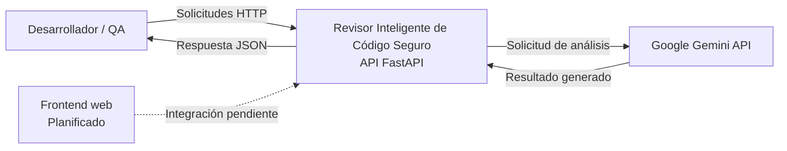
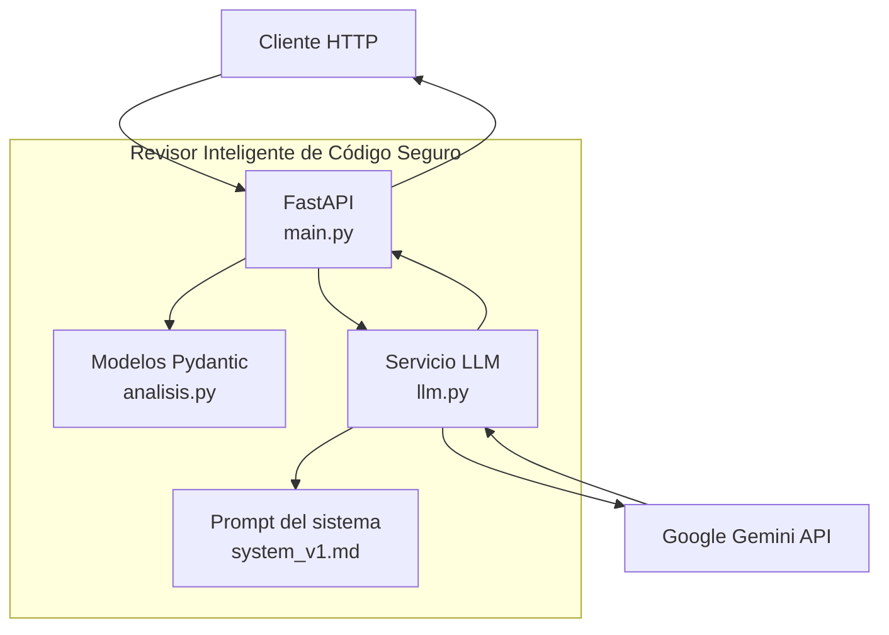

# 03. Arquitectura del sistema

- **Proyecto:** Revisor Inteligente de Código Seguro
- **Rama de trabajo:** `feature/qa-seguridad`
- **Estado:** Arquitectura inicial documentada; validación e integración pendientes de completar con el equipo.

## 1. Problema que resolvemos


La revisión manual de código puede consumir tiempo y dificultar la identificación sistemática de errores de calidad y posibles vulnerabilidades de seguridad.

El proyecto busca facilitar la revisión estática de código Python mediante una API que recibe fragmentos de código, solicita su análisis a un modelo de inteligencia artificial y devuelve hallazgos estructurados.

El sistema debe tratar el código recibido como contenido no confiable y no ejecutarlo como parte del análisis.

## 2. Objetivo del sistema

Desarrollar un revisor inteligente de código Python que permita:

- Recibir solicitudes de análisis mediante una API HTTP.
- Validar las entradas antes de procesarlas.
- Solicitar el análisis a Google Gemini.
- Devolver hallazgos con línea, severidad, categoría, explicación y corrección sugerida.
- Gestionar los errores del proveedor de IA mediante respuestas controladas.
- Proteger las credenciales y evitar la exposición de información sensible.
- Facilitar las pruebas automatizadas y la verificación de los controles de seguridad.

## 3. Arquitectura C4: nivel 1, contexto

### 3.1. Actores y sistemas externos

**Desarrollador o responsable de QA**

Envía código Python para su revisión y consulta los resultados del análisis.

**Revisor Inteligente de Código Seguro**

Sistema backend que expone una API, valida las solicitudes y coordina el análisis mediante inteligencia artificial.

**Google Gemini API**

Servicio externo que recibe el contenido destinado al análisis y genera una respuesta estructurada.

**Frontend web**

Componente previsto para facilitar la interacción con el sistema. La implementación e integración del frontend no están confirmadas en el código revisado.

### 3.2. Diagrama de contexto



El flujo principal implementado corresponde a la comunicación HTTP con el backend y la solicitud de análisis al proveedor de IA.

La integración del frontend debe verificarse cuando exista una implementación funcional.

## 4. Arquitectura C4: nivel 2, contenedores

### 4.1. Backend API

**Tecnología:** Python y FastAPI.

**Ubicación:** `backend/app/`

Responsabilidades:

- Exponer los endpoints HTTP.
- Validar las solicitudes mediante modelos Pydantic.
- Ejecutar el flujo de análisis de forma controlada.
- Delegar la comunicación con el proveedor de IA al servicio correspondiente.
- Validar la estructura de la respuesta.
- Gestionar los errores conocidos del proveedor.

Archivos principales:

- `backend/app/main.py`: aplicación FastAPI y endpoints.
- `backend/app/models/analisis.py`: modelos de entrada y salida.
- `backend/app/services/llm.py`: integración con el proveedor de IA.
- `backend/app/prompts/system_v1.md`: instrucciones del análisis.

### 4.2. Servicio de inteligencia artificial

**Tecnología:** biblioteca Python `google-genai`.

**Proveedor implementado:** Google Gemini.

El servicio obtiene la clave de API desde la variable de entorno `GEMINI_API_KEY`, carga las instrucciones del sistema y envía el código recibido para su análisis.

La respuesta se valida mediante el modelo `InformeModelo`. También se comprueba que los números de línea indicados por los hallazgos no superen el número de líneas del código recibido.

### 4.3. Frontend

La carpeta `frontend` existe en el repositorio, pero no se ha confirmado una aplicación funcional en el código revisado.

La interfaz web y su integración con la API quedan pendientes de verificación e implementación.

### 4.4. Persistencia

No se ha confirmado una base de datos ni un mecanismo de persistencia de resultados en los componentes examinados.

### 4.5. Diagrama de contenedores



El diagrama representa la organización lógica del backend. El prompt es un archivo de configuración del análisis, no un servicio independiente.

## 5. Tecnologías identificadas

| Tecnología | Uso |
|---|---|
| Python | Lenguaje del backend. |
| FastAPI | Exposición de la API HTTP. |
| Pydantic | Validación de solicitudes y respuestas. |
| Google GenAI SDK | Comunicación con Google Gemini. |
| pytest | Pruebas automatizadas. |
| FastAPI TestClient | Pruebas de los endpoints. |
| unittest.mock | Simulación de dependencias durante las pruebas. |
| python-dotenv | Carga de variables de entorno desde `.env`. |
| Git y GitHub | Control de versiones y colaboración. |

La implementación examinada utiliza Gemini. Aunque `.env.example` incluye variables de configuración para Groq, no se ha confirmado que exista un proveedor de respaldo funcional en el servicio actual.

## 6. Endpoints principales

### 6.1. GET `/health`

**Estado:** implementado.

Comprueba que la API responde.

Respuesta esperada:

```json
{
  "status": "ok",
  "service": "revisor-inteligente-codigo",
  "version": "0.1.0"
}
```

### 6.2. POST `/api/v1/analizar`

**Estado:** implementado.

Recibe el nombre del archivo y el código Python que se desea analizar.

Ejemplo de solicitud:

```json
{
  "archivo": "ejemplo.py",
  "codigo": "print('hola')"
}
```

Validaciones identificadas:

- `archivo`: cadena de entre 1 y 255 caracteres.
- `codigo`: cadena de entre 1 y 12.000 caracteres.

La solicitud se valida mediante `SolicitudAnalisis`.

La respuesta utiliza el modelo `RespuestaAnalisis` y contiene el nombre del archivo, el estado del análisis y la lista de hallazgos.

Cada hallazgo incluye:

- `linea`: número de línea, igual o superior a 1.
- `severidad`: `critica`, `alta`, `media` o `baja`.
- `categoria`: categoría del hallazgo.
- `titulo`: descripción breve.
- `explicacion`: motivo del hallazgo.
- `correccion_sugerida`: propuesta de corrección.

El servicio devuelve errores HTTP controlados para varios escenarios conocidos del proveedor. Las pruebas test_servicio_controla_timeout_504 y test_servicio_controla_timeout_real pasaron en la última ejecución completa registrada.

La consulta de repositorios no se ha confirmado como endpoint implementado.

### 6.3. POST `/api/v1/archivos`

**Propósito:** analizar un archivo Python individual.

- Entrada: archivo multipart/form-data en el campo `archivo`.
- Formato permitido: `.py`.
- Tamaño máximo documentado: 1 MiB.
- Longitud máxima del código: 12.000 caracteres.
- Requiere codificación UTF-8.
- Rechaza entradas inválidas según las validaciones del backend.
- El contenido no debe ejecutarse como código.

### 6.4. POST `/api/v1/archivos/zip`

**Propósito:** analizar los archivos Python de un proyecto ZIP.

- Entrada: archivo multipart/form-data en el campo `archivo`.
- Tamaño máximo documentado del ZIP: 5 MiB.
- Se permiten hasta 100 entradas y 20 MiB de contenido descomprimido declarado por ZIP.
- Se admiten como máximo cinco archivos Python, de hasta 1 MiB cada uno; el código acumulado se limita a 12.000 caracteres.
- Se verifican ZIP corruptos y rutas inseguras.
- El código recibido no debe ejecutarse.

## 7. Flujo de análisis

1. El cliente envía una solicitud HTTP al endpoint `/api/v1/analizar`.
2. FastAPI valida los campos recibidos mediante `SolicitudAnalisis`.
3. La aplicación delega el análisis en `analizar_codigo` mediante `run_in_threadpool`.
4. El servicio obtiene la configuración y la clave de Gemini.
5. Lee las instrucciones de `system_v1.md`.
6. Envía el código al proveedor de IA como contenido que debe analizarse.
7. Valida la respuesta con `InformeModelo`.
8. Comprueba que las líneas de los hallazgos existan en el código recibido.
9. Devuelve una respuesta estructurada al cliente o comunica un error controlado cuando corresponde.

El código recibido no debe ejecutarse ni importarse durante este flujo.

## 8. Configuración y credenciales

La configuración utiliza variables de entorno para evitar incluir credenciales directamente en el código fuente.

Variables identificadas en el servicio:

- `GEMINI_API_KEY`: clave de acceso al proveedor.
- `GEMINI_MODEL`: modelo configurado; el código utiliza `gemini-3.8-flash` como valor predeterminado cuando no se especifica otro.
- `LLM_TIMEOUT_SECONDS`: tiempo máximo de espera configurado; el valor predeterminado del código es de 60 segundos.
- `LLM_MAX_OUTPUT_TOKENS`: máximo de tokens de salida; el valor predeterminado es 2048.

El archivo `.env.example` sirve como plantilla de configuración. El archivo `.env` está excluido de Git en la configuración examinada.

**Limitación identificada:** `.env.example` también contiene variables de temperatura, reintentos y proveedor de respaldo. No se ha confirmado que todas esas opciones estén conectadas al comportamiento efectivo de `llm.py`.

## 9. Requisitos no funcionales y controles de seguridad

### 9.1. Validación de entradas

- Rechazar solicitudes que incumplan los límites de los modelos.
- Limitar la longitud del código y del nombre de archivo.
- Mantener y ampliar las validaciones de carga de archivos según los límites y escenarios de seguridad definidos.

### 9.2. Aislamiento del código

- Tratar el código recibido como contenido no confiable.
- No ejecutar ni importar el código analizado.
- Revisar que futuras funcionalidades no introduzcan vías de ejecución accidental.

### 9.3. Protección de credenciales

- Obtener las claves mediante variables de entorno.
- Mantener los archivos `.env` fuera del repositorio.
- No incluir claves en respuestas HTTP ni en los registros.

### 9.4. Gestión de errores

- Diferenciar los errores conocidos del proveedor.
- Evitar devolver mensajes internos que contengan credenciales.
- Controlar los errores de timeout y validar su transformación en respuestas HTTP adecuadas.

### 9.5. Instrucciones dirigidas a la IA

- Tratar comentarios y cadenas del código como datos, no como instrucciones.
- Mantener las instrucciones de sistema separadas del código analizado.
- Validar estructuralmente las respuestas del modelo.
- Incorporar pruebas específicas contra intentos de manipulación del análisis.

### 9.6. Registros

Los registros examinados incluyen información sobre el modelo, la duración de la solicitud y el uso de tokens. Los registros de errores del proveedor incluyen el modelo y el código de estado.

Las pruebas deben comprobar que no se expongan credenciales ni código sensible.

Estos requisitos deben verificarse mediante pruebas y revisión de código; su inclusión en la documentación no demuestra por sí sola que estén completamente implementados.

## 10. Estado de QA y pruebas

Las pruebas automatizadas cubren el endpoint de salud, la validación de solicitudes, la estructura de las respuestas y varios errores del servicio de IA.

En la última ejecución registrada:

- Pruebas aprobadas: 15.
- Pruebas fallidas: 1.
- Total: 16.

La prueba fallida es `test_servicio_controla_timeout_real`. Se propagó una excepción `httpx.TimeoutException` que el servicio no transformó en el error controlado esperado.

**Estado:** corrección pendiente y nueva ejecución completa de la suite de pruebas.

Las evidencias de ejecución se almacenan en `docs/evidencias/semana-2/pytest-resultados.txt`.

## 11. Componentes pendientes para la semana 3

- Corregir y verificar el tratamiento de `httpx.TimeoutException`.
- Ejecutar nuevamente la suite completa y actualizar las evidencias.
- Confirmar con el equipo el contrato definitivo de la API.
- Definir si la carga de archivos y el procesamiento de ZIP forman parte del alcance del MVP.
- Definir si se implementará la consulta de repositorios y sus controles de acceso.
- Confirmar las decisiones sobre proveedor de respaldo y configuración de reintentos.
- Implementar o integrar el frontend si forma parte del alcance aprobado.
- Completar las pruebas específicas de seguridad y de resistencia ante instrucciones maliciosas.
- Actualizar la arquitectura cuando se aprueben nuevas decisiones técnicas.

## 12. Validación del equipo

Esta documentación refleja el backend y las pruebas revisadas hasta el momento.

Los componentes identificados como pendientes no deben considerarse implementados hasta que exista código funcional y se hayan realizado las verificaciones correspondientes.

La arquitectura definitiva deberá validarse con el responsable del backend y el resto del equipo, especialmente en lo relativo al alcance del MVP, la integración del frontend, la carga de archivos y las decisiones de seguridad.
