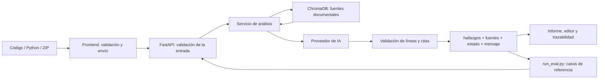

# Integración de frontend, backend y evaluación

Fecha: 30 de octubre de 2026. Rama de trabajo: `feature/frontend`. Propuesta de revisión: [PR #5](https://github.com/Christian-gv-01/revisor-inteligente-codigo/pull/5).

## Entregables del Compañero 2

| Responsabilidad | Implementación | Estado |
|---|---|---|
| Mostrar fuentes del backend | `FindingsPanel`, `SourceList`, `EvidenceTrace`, normalización por archivo | Implementado y comprobado |
| Preparar 20 preguntas y ejecutor | `eval/preguntas_referencia.json`, `eval/run_eval.py` | Preparado; recuperación real ejecutada |
| Resultados, métricas y errores | `docs/07-evaluacion.md` | Documentado, con limitaciones explícitas |
| Evidencias de semana 3 | `docs/evidencias/semana-3/` | Registros, JSON, CSV y capturas guardados |
| Integración conjunta | `eval/run_integration.py`, `frontend/tests/integration-http.test.tsx` | 9 pruebas HTTP aprobadas |
| Evaluación completa con Gemini | Modo `api` del evaluador, contra backend configurado | Pendiente de `GEMINI_API_KEY` |

## 1. Cómo se conectan las partes



En el uso normal, la IA se llama desde el backend. El frontend no recibe la clave ni ejecuta el código Python. La evaluación utiliza las mismas rutas y contratos del sistema.

### Entrada y endpoints

| Entrada | Ruta | Transporte |
|---|---|---|
| Texto Python | `POST /api/v1/analizar` | JSON con `archivo` y `codigo` |
| Archivo `.py` | `POST /api/v1/archivos` | Multipart, campo `archivo` |
| Proyecto ZIP | `POST /api/v1/archivos/zip` | Multipart, campo `archivo` |

El frontend valida datos y archivos antes de enviar. FastAPI aplica su propia validación; el servidor no depende de que el navegador haya validado correctamente.

### Respuesta y fuentes

Una respuesta individual contiene:

```json
{
  "archivo": "usuarios.py",
  "estado": "analizado",
  "hallazgos": [{ "referencias": ["seguridad_python-002"] }],
  "fuentes": [{ "id": "seguridad_python-002" }],
  "mensaje": null
}
```

Este JSON abrevia los demás campos para explicar la relación. Los modelos completos están en `backend/app/models/analisis.py`.

El frontend une `hallazgos[].referencias` con `fuentes[].id`. Muestra título, sección, ID y enlace del documento. Un clic en un hallazgo selecciona su línea cuando existe código disponible y actualiza la trazabilidad. El informe descargado conserva los mismos datos.

En ZIP, esa asociación se hace dentro del informe de cada archivo. Una fuente recibida solo para otro archivo no sirve para resolver una cita incompleta. La API aún no entrega el código contenido en el ZIP; la interfaz informa esa limitación.

Si faltan fuentes o el backend rechaza citas, `estado` es `abstenido`: se presenta el motivo, sin mostrarlo como código seguro. Si solo se abstiene parte de un ZIP, la advertencia identifica esos archivos. Un error HTTP se muestra como error y no como una lista vacía de hallazgos.

## 2. Cómo se integró la evaluación

El conjunto tiene 20 preguntas propias: 12 fragmentos con riesgos esperados, 6 controles negativos y 2 casos fuera de cobertura documental. Cada caso incluye código, respuesta de referencia, fuentes y líneas esperadas. El código se comprueba como texto/sintaxis; no se ejecuta.

`run_eval.py` dispone de dos modos:

- `rag`: utiliza el flujo real de recuperación del backend y no llama a Gemini. Produce Precision@3, Recall@3, MRR@3, cobertura, latencia y errores.
- `api`: envía los casos a FastAPI y compara las respuestas con las etiquetas. Está preparado para precisión, recall, F1, citas y abstención. Los errores y denominadores vacíos se registran explícitamente.

Cada corrida crea una carpeta nueva con JSON, CSV y resumen, además de fecha, revisión y hashes. Las métricas de recuperación se calculan sobre los casos con referencias etiquetadas; no son porcentajes de calidad de las respuestas de IA.

## 3. Qué verifica la nueva integración HTTP

Se añadió una prueba reproducible del flujo conjunto. El ejecutor inicia una instancia temporal de **la aplicación FastAPI del proyecto**, en un puerto local libre. Mantiene reales sus rutas, validación de archivos, servicio de análisis, recuperación ChromaDB, comprobación de citas y serialización.

Se sustituye únicamente el cliente externo de Gemini por respuestas controladas dentro de ese proceso de prueba. No se modifica el `.env`, no se cambia el backend que está usando el usuario y no se consume cuota de IA. El servidor temporal se apaga al terminar. El adaptador HTTP del frontend utiliza `fetch` real y comprueba que el servidor esté identificado como prueba antes de continuar.

Se aprobaron estas nueve comprobaciones:

1. JSON del frontend a FastAPI y resolución de referencias recuperadas en ChromaDB.
2. Presentación y exportación de las fuentes recibidas del backend.
3. Carga multipart de un archivo Python válido.
4. ZIP con un archivo analizado y otro abstenido, conservando el aviso parcial.
5. Abstención por hallazgo sin citas.
6. Abstención por cita inexistente.
7. Distinción entre un informe analizado sin hallazgos y una abstención.
8. Conversión de un timeout del proveedor simulado en HTTP 504 y error de servidor en el frontend.
9. Rechazo de un archivo no Python en el endpoint real.

Adicionalmente, `request_analysis` y `validate_response` del evaluador se ejecutaron contra ese mismo servidor HTTP. Así se comprueba que el evaluador también consume el contrato de FastAPI.

Estas pruebas **no miden la calidad de Gemini**. La respuesta generativa está simulada; no se publican precisión, recall ni F1 de IA a partir de ella. La recuperación de ChromaDB sí es real. Las pruebas de renderizado de la integración usan los componentes React del proyecto y no sustituyen a las capturas de navegador del rediseño, guardadas en su carpeta específica.

## 4. Resultados y evidencias

| Grupo | Resultado actual |
|---|---|
| Frontend, suite habitual | 58 aprobadas; las 9 HTTP se omiten cuando no se ha iniciado el ejecutor de integración |
| Integración HTTP dedicada | 9/9 aprobadas |
| Backend, suite existente | 58/58 aprobadas |
| Evaluador, fórmulas y contrato | 10/10 aprobadas |
| Dataset | 20 casos válidos |
| ESLint | Sin errores |
| Recuperación real del conjunto de referencia | 20/20 ejecutados; Recall@3 medio 94,44 % sobre 18 casos etiquetados |
| Evaluación completa de Gemini | Pendiente: backend local sin clave; evidencia previa de HTTP 503 |

La evidencia nueva está en [`evidencias/semana-3/integracion-http/`](evidencias/semana-3/integracion-http/README.md). El informe de resultados y limitaciones está en [`07-evaluacion.md`](07-evaluacion.md).

## 5. Cómo reproducirlo

Desde la raíz del repositorio, con el entorno del backend y las dependencias del frontend instaladas:

```powershell
# Verificar el conjunto de preguntas
.\.venv\Scripts\python.exe eval/run_eval.py --validate-only

# Verificar las integraciones, sin clave ni llamadas a Gemini
.\.venv\Scripts\python.exe eval/run_integration.py

# Evaluar la recuperación real de documentos
.\.venv\Scripts\python.exe eval/run_eval.py --mode rag
```

Si no existe la base vectorial, ejecutar antes `scripts/ingest.py` con ese mismo Python. No es necesario tener el backend normal levantado para la prueba de integración: el ejecutor crea su instancia temporal.

Para evaluar las respuestas reales, el responsable de backend debe configurar su clave local, reiniciar FastAPI y ejecutar:

```powershell
.\.venv\Scripts\python.exe eval/run_eval.py --mode api --base-url http://127.0.0.1:8000
```

## 6. Integración en GitHub

Los cambios se publican en `feature/frontend` y actualizan el PR #5 hacia `main`. La incorporación final a `main` queda sujeta a la revisión del equipo. Se mantiene explícita la revisión del backend usada en cada evidencia; si el equipo incorpora las mejoras RAG de otras ramas, se deben repetir la ingesta, la recuperación y la prueba HTTP contra esa nueva revisión.
