# RAG: fuentes, interfaz y evaluación

**Proyecto:** Revisor Inteligente de Código Seguro — UNIANDES.

**Responsable de esta entrega:** Compañero 2, Frontend y Evaluación.

**Fecha:** 30 de octubre de 2026. **Rama:** `feature/frontend`.

## 1. Objetivo y alcance

El RAG recupera fragmentos documentales para proporcionar contexto al modelo y permitir rastrear el respaldo de los hallazgos. La entrega de Frontend y Evaluación comprueba cómo se presentan esas referencias y cómo se mide la recuperación.

Este documento cubre el contrato de fuentes, su visualización, los estados de respuesta, el conjunto de referencia, las métricas, las evidencias y la revisión manual de citas. La ingesta, los embeddings y el almacenamiento se describen en [06-rag.md](06-rag.md); su configuración y evolución corresponden al responsable del RAG/backend.

La corrida de recuperación parte de la revisión `8f27ddc9971f328ae122e6c71e50726ef898c1f0`, con hashes y cambios locales registrados en su resultado. Sus cifras no se atribuyen a otras ramas o versiones de la base de conocimiento.

## 2. Flujo del RAG hacia la interfaz

```mermaid
flowchart LR
    Codigo["Código Python como texto"] --> Consulta["Transformación de consulta"]
    Consulta --> Chroma["Recuperación en ChromaDB"]
    Chroma --> Contexto["Fragmentos e IDs de seguridad"]
    Contexto --> Modelo["Generación de hallazgos"]
    Modelo --> Validacion["Validación de líneas y citas"]
    Validacion --> API["Respuesta de FastAPI"]
    API --> Interfaz["Informe, editor y trazabilidad"]
```



El código recibido no se ejecuta. Recuperar un documento no demuestra por sí mismo que exista una vulnerabilidad ni que una explicación generada sea correcta.

El diseño distingue las colecciones `seguridad_python`, para respaldo documental de seguridad, y `contexto_proyecto`, para contexto interno. La corrida local de veinte casos utilizó solo la primera, con cuatro fragmentos. Las evidencias históricas de otras colecciones se conservan aparte.

## 3. Contrato de fuentes y citas

| Campo de la respuesta | Uso |
|---|---|
| `archivo` | Identifica el archivo analizado |
| `estado` | `analizado` o `abstenido` |
| `hallazgos` | Línea, severidad, explicación y corrección de cada problema reportado |
| `hallazgos[].referencias` | IDs exactos citados por el hallazgo |
| `fuentes` | Metadatos de los fragmentos recuperados |
| `mensaje` | Motivo de abstención u observación conservada |

Cada fuente contiene `id`, `documento`, `seccion`, `fuente`, `url` y `distancia`.

La interfaz une `hallazgos[].referencias` con `fuentes[].id` por igualdad exacta. Por ejemplo, una cita `seguridad_python-002` se resuelve con la fuente que devuelve ese mismo ID; no se asigna por parecido entre títulos.

En ZIP, la relación se resuelve dentro del informe de cada archivo antes de combinar resultados. No se completa una cita con metadatos recibidos exclusivamente para otro archivo.

Los IDs de la ingesta de seguridad dependen del orden de las secciones Markdown. Si se reorganiza el conocimiento, el equipo debe comprobar otra vez los IDs y las etiquetas antes de comparar métricas.

## 4. Presentación en el frontend

El respaldo documental de cada hallazgo muestra nombre de la fuente, sección, identificador y enlace. Los campos se separan visualmente para facilitar su lectura en escritorio y móvil.

Las fuentes generales consultadas se pueden desplegar aparte de las citas individuales. Un documento recuperado puede ser relevante para la consulta sin respaldar todos los hallazgos.

Seleccionar un hallazgo actualiza su línea en el editor, cuando existe el contenido del archivo, y la sección de trazabilidad. El informe JSON conserva modo, fecha, estado, mensaje, archivos, hallazgos y fuentes.

Los textos del backend se renderizan como texto de React. Los enlaces admitidos son HTTP/HTTPS absolutos y sin credenciales. Una referencia sin metadatos muestra un aviso; no se inventa su origen. La distancia semántica no se presenta como un porcentaje de confianza.

| Situación | Respuesta de la interfaz |
|---|---|
| Carga en curso | Muestra espera y oculta las relaciones anteriores |
| IDs resueltos | Muestra las fuentes del hallazgo correspondiente |
| Cita sin metadatos | Indica que no se puede comprobar su origen |
| `analizado` sin hallazgos | Informa que no se reportaron problemas, sin certificar seguridad |
| `abstenido` | Muestra el motivo y la falta de evidencia suficiente |
| ZIP parcialmente abstenido | Conserva la advertencia por archivo |
| Error HTTP o de conexión | Muestra el error; no lo convierte en cero hallazgos |
| Modo Demo | Identifica datos y referencias ilustrativos, sin recuperación RAG |

La API actual no devuelve el código contenido en un ZIP. La interfaz permite consultar sus hallazgos y líneas, pero informa que falta el contenido para resaltarlas.

## 5. Conjunto de veinte preguntas

Archivo: [preguntas_referencia.json](../eval/preguntas_referencia.json).

Cada caso incluye pregunta, código, archivo, respuesta de referencia, IDs esperados, estado esperado y hallazgos con líneas admisibles. La pregunta explica el propósito de la prueba; la API recibe únicamente `archivo` y `codigo`.

| Casos | Tema | Distribución |
|---|---|---|
| P01–P06 | SQL | 4 con riesgo y 2 controles negativos |
| P07–P12 | Comandos del sistema | 4 con riesgo y 2 controles negativos |
| P13–P18 | Ejecución dinámica | 4 con riesgo y 2 controles negativos |
| P19–P20 | Fuera de cobertura documental | 2 abstenciones esperadas |

Las etiquetas se basan en las cuatro reglas de `knowledge/seguridad_python.md` de la versión evaluada. Son una propuesta propia para revisión del equipo, no un conjunto externo validado. Un control negativo puede tener documentación relevante sobre su mecanismo seguro.

## 6. Método y resultados de recuperación

[run_eval.py](../eval/run_eval.py) utiliza la transformación de consulta y la recuperación del analizador real. Su modo `rag` no llama a Gemini. La corrida usó `k = 3`, distancia máxima `0,75` y una consulta de calentamiento fuera de la latencia medida.

| Métrica | Definición | Resultado |
|---|---|---:|
| Completitud | Casos sin error / casos totales | 20/20, 100 % |
| Precision@3 media | IDs relevantes entre los tres primeros / 3 | 53,70 % |
| Recall@3 medio | IDs relevantes recuperados / IDs relevantes esperados | 94,44 % |
| MRR@3 medio | Inverso de la posición del primer ID relevante | 88,89 % |
| Hit@3 | Casos con algún ID relevante entre los tres primeros | 17/18, 94,44 % |
| Sin fuentes fuera de cobertura | Casos fuera de cobertura sin fuentes recuperadas | 2/2 |
| Latencia media | Transformación, recuperación y procesamiento tras calentamiento | 320,20 ms |
| Latencia p95 | Percentil por rango más próximo | 339,21 ms |

Precision@3, Recall@3, MRR@3 y Hit@3 se agregan sobre los **18 casos con referencias esperadas**. Los dos restantes no se agregan como recall perfecto. Al tener uno o dos documentos etiquetados por caso, la Precision@3 máxima de este conjunto sería 55,56 %. No es una medida de exactitud de la IA.

Evidencia íntegra con procedencia y respuestas: [JSON](evidencias/semana-3/rag-20-casos/resultados.json), [CSV](evidencias/semana-3/rag-20-casos/resultados.csv) y [resumen](evidencias/semana-3/rag-20-casos/resumen.md).

Estas cifras no se mezclan con el experimento histórico de cuatro consultas de `06-rag.md` ni se extrapolan a una base ampliada o a cambios posteriores del recuperador.

## 7. Revisión semántica de las citas

La validación estructural comprueba que el ID citado exista en las fuentes recibidas. Determinar si el documento sustenta el hallazgo exige revisar su contenido y el código.

Al disponer de respuestas reales de IA, registrar por caso:

1. Si la línea y el riesgo descritos existen en el fragmento.
2. Si el documento corresponde al tipo de riesgo.
3. Si su contenido respalda la explicación concreta, no solo el tema general.
4. Si la corrección responde al riesgo y es coherente con el código.
5. Si la abstención fue apropiada cuando faltaba evidencia.

Se propone esta rúbrica para la pertinencia documental:

| Puntuación | Criterio |
|---|---|
| 0 | Fuente ausente, irrelevante o contraria a la afirmación |
| 1 | Fuente relacionada, pero insuficiente para la afirmación concreta |
| 2 | Fuente directamente pertinente y suficiente para esa afirmación |

Conservar el caso, la respuesta, los IDs, la puntuación, su justificación y la persona revisora. Un ID resuelto o un enlace accesible no basta para asignar 2. Esta revisión completa sigue pendiente; no se atribuyen puntuaciones a respuestas aún no revisadas.

## 8. Errores encontrados y recomendaciones del rol

| Hallazgo | Tratamiento |
|---|---|
| Campos de fuentes concatenados visualmente | Corregido con tarjetas y separación de campos |
| Atribución de fuentes de otro archivo ZIP | Corregido con resolución dentro del informe individual |
| Pérdida del estado o motivo al exportar | Corregido; ambos se conservan en JSON |
| P18 no recuperó su referencia etiquetada | Revisar primero la etiqueta; es un control negativo y no demuestra una vulnerabilidad omitida |
| HTTP 503 en evaluación generativa local | Falta configurar Gemini; esos errores no se cuentan como respuestas correctas |
| Muestra limitada y etiquetas propias | Revisar etiquetas y ampliar repeticiones antes de generalizar |

Las propuestas sobre fragmentación, embeddings, umbral o filtros se deben comunicar al responsable del RAG con sus casos y evidencias. Esta entrega documenta el diagnóstico y no incorpora cambios internos de otros integrantes.

## 9. Integración técnica comprobada

[run_integration.py](../eval/run_integration.py) inicia FastAPI real y utiliza ChromaDB local real. Sustituye solo el cliente externo de IA por respuestas controladas dentro del proceso temporal.

Se aprobaron nueve pruebas HTTP: JSON, presentación/exportación de fuentes, Python multipart, ZIP parcial, dos escenarios de citas rechazadas, resultado vacío válido, timeout y archivo inválido. La suite habitual del frontend aprobó 58 pruebas; las nueve HTTP se omiten sin el servidor temporal y se ejecutan con ese script.

Las [evidencias de integración](evidencias/semana-3/integracion-http/README.md) comprueban conexiones y respuestas, no calidad generativa. Las [capturas del frontend](evidencias/semana-3/redisenointerfaz/README.md) muestran la aplicación con datos de ejemplo identificados.

## 10. Reproducción y cierre

Desde la raíz, con las dependencias instaladas en `.venv`:

```powershell
# Comprobar las veinte preguntas sin ejecutar su código
.\.venv\Scripts\python.exe eval/run_eval.py --validate-only

# Recuperación real sin llamar a Gemini
.\.venv\Scripts\python.exe eval/run_eval.py --mode rag

# Integración HTTP con la respuesta de IA controlada
.\.venv\Scripts\python.exe eval/run_integration.py
```

Si falta la base vectorial, el responsable debe preparar la ingesta correspondiente. Cada corrida crea una carpeta nueva de evidencias. Si cambia el conocimiento o la recuperación, hay que comprobar los IDs esperados y volver a registrar las métricas.

Cuando el responsable de backend facilite una API con Gemini configurado:

```powershell
.\.venv\Scripts\python.exe eval/run_eval.py --mode api --base-url http://127.0.0.1:8000
```

Para otro equipo, sustituir la dirección por la API accesible que proporcione el responsable y registrar su revisión, modelo y configuración. Ese modo puede consumir cuota del proveedor configurado.

La entrega queda preparada para revisión en `feature/frontend`. La validación final requiere respuestas reales, revisión semántica e integración de las ramas autorizadas por el equipo. El informe principal de resultados está en [07-evaluacion.md](07-evaluacion.md).
